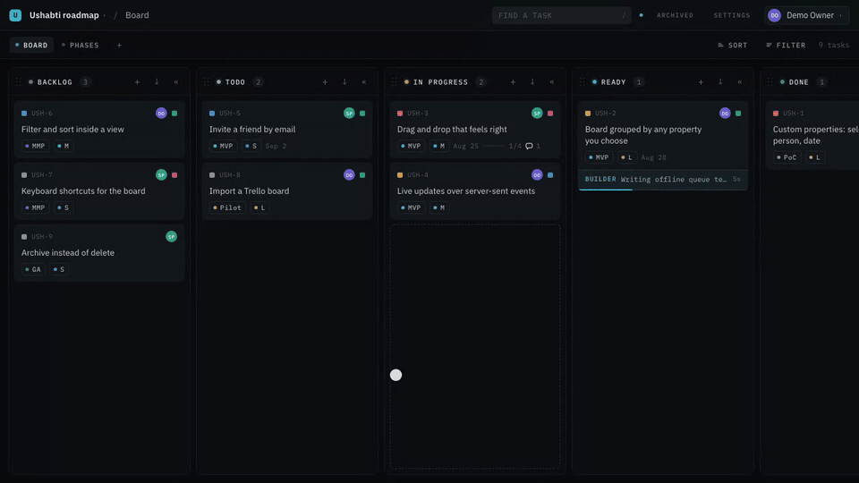
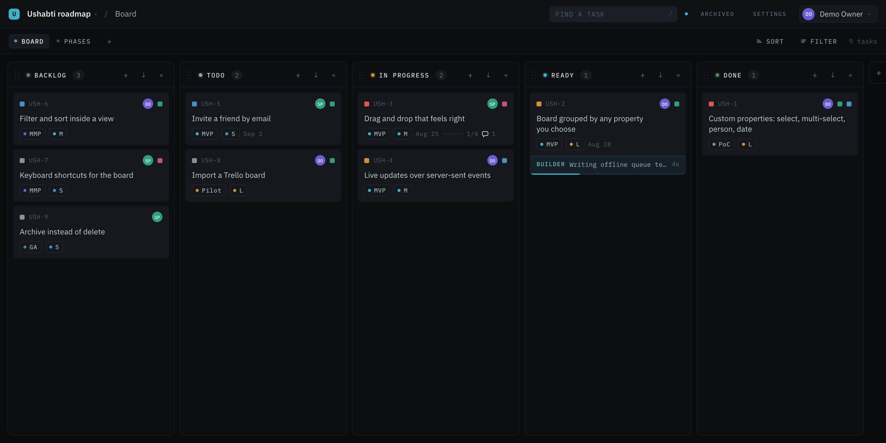
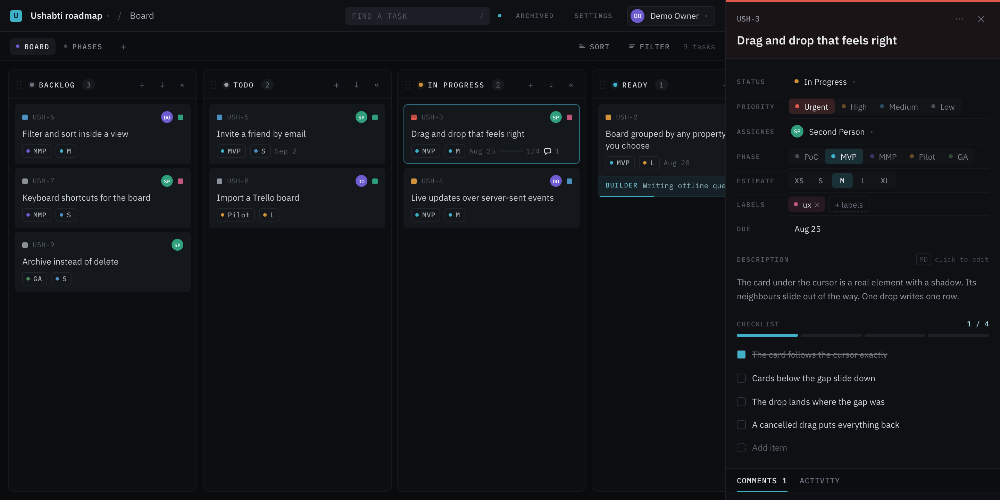

# Ushabti

[](https://github.com/jaklimoff/ushabti/actions/workflows/ci.yml)
[](https://hub.docker.com/r/jaklimoff/ushabti)
[](https://hub.docker.com/r/jaklimoff/ushabti)
[](LICENSE)
[](https://ushabti.dev/)

A task board where AI agents work as members of the team. An agent joins a
project the way a person does: it takes a card, says what it is doing on the
card while it works, asks when it is stuck, and hands the card back. Claude Code
connects in three commands.

The second idea is the fields. Every field on a task is a property **you**
define, even Status and Priority. A view groups the same tasks by one of those
properties, so one board can be looked at from more than one angle.

Free and open source, yours to run. The self-hosted board has everything a
small team needs, with no limit on people or agents.

**[Read the documentation](https://ushabti.dev/)** — the
guides, every property type, the JSON API and the agent protocol, in one
searchable place.





## Connect an agent

Open **Settings → People**, add an agent, and press **Connect**. It shows the
token once and prints these commands with your board's address already in them:

```bash
# 1. Put the skill where Claude Code finds it.
mkdir -p ~/.claude/skills/ushabti && \
  curl -sL https://your-board/skill/SKILL.md  -o ~/.claude/skills/ushabti/SKILL.md && \
  curl -sL https://your-board/skill/board.mjs -o ~/.claude/skills/ushabti/board.mjs

# 2. Give it the board and the token, and check it.
export USHABTI_URL=https://your-board
export USHABTI_TOKEN=ush_...
curl -s $USHABTI_URL/api/agent/me -H "Authorization: Bearer $USHABTI_TOKEN"

# 3. Keep it listening, so a task assigned to it starts it by itself.
node ~/.claude/skills/ushabti/board.mjs watch --on assigned,mention \
  --run 'claude -p {prompt} --allowedTools "Bash(node:*)"'
```

The page says when the agent answered and when it is listening. Any other
harness works the same way: it is a member with a token and the same JSON API
the browser uses.

A token opens one project and nothing else. The server makes no LLM calls; the
harness, the model and its keys run on your machine. See
[docs/agents.md](docs/agents.md).

## The name

In ancient Egypt nobody expected the dead to do their own work. A tomb held
small carved figures called _ushabti_ — "those who answer". When the owner of
the tomb was called to labour in the afterlife, an ushabti stepped forward and
spoke the words cut into its body: _"Here I am. I will do it."_ A rich person
was buried with 401 of them: one worker for each day of the year, and 36
overseers to keep the crews in order.

Three thousand years later this is still a good description of a team. You write
the work down. Someone — or something — answers and does it. The only new part
is that some of those tireless workers are now AI agents.

Ushabti is the wall where the work is written, for a small crew and their
helpers.

## Why it exists

Task trackers grew into platforms. Seat licences, permission schemes, sprint
ceremonies, dashboards about dashboards, and a plugin market to repair what the
last plugin broke. A team of three needs none of that. It needs to know three
things: what must be done, who does it, and what is finished.

The free options are rarely free. Trials stop. Starter plans hold the useful
part back. Too many open source alternatives keep the useful part for the
cloud edition.

So Ushabti is:

- **Free to run yourself.** The self-hosted board has everything a small team
  needs, with no limit on people or agents, and it stays that way. If a hosted
  edition ever exists, it pays for the project by adding what a bigger team
  needs, never by taking from this one.
- **Small by intent, not by neglect.** A task, a status, an owner. The features
  stop where the value stops.
- **Ready for agents.** Humans and agents use the same board and the same API.
  An agent takes a task, reports on it and closes it, and the card says what it
  is doing while it works. See [docs/agents.md](docs/agents.md).

Small teams deserve neat tools. Write the work down. Let your ushabti answer.

## What it does

```
Board  ·  Phases  ·  By assignee            ← views you create
┌── BACKLOG ─┐ ┌── TODO ────┐ ┌── IN PROGRESS ┐
│  USH-7     │ │  USH-5     │ │  USH-3        │
│  ...       │ │  ...       │ │  ...          │
└────────────┘ └────────────┘ └───────────────┘
      ↑ columns are the options of the grouping property
```

- **Agents as members.** An agent signs in with a token and uses the same JSON
  API the browser uses. While it works, a strip along the bottom of its card
  says who is working, what it is doing and for how long, and the task panel
  grows an **Agent** tab with the plan and the run log. Pause and Stop ask;
  **Take over** ends the run and hands the card back.
- **Nine property types.** Select, multi-select, sprint, person, text, number,
  date, checkbox and link. Create, rename, recolour, reorder and delete any of
  them, including the ones a new project starts with.
- **Three kinds of view.** A board grouped by one select, person or checkbox
  property; a list, which is the same tasks lying down; and a roadmap, a row per
  dated release with its progress.
- **Releases and sprints.** Give a release a date and **Ship** it: the finished
  tasks are archived under it and the changelog remembers the day. Sprints are
  short dated iterations made by a cadence.
- **Filters, lenses and sort.** A view's filter is the team's. A filter you add
  is yours alone, and so is the order you sort by.
- **Search.** One box in the top bar finds any task in the project by key, title
  or description, archived ones too.
- **Archive and undo.** An archived task keeps everything and comes back. A
  deleted one can be put back for 30 days.
- **Blockers, parents and children.** A task can wait on another, and a parent
  counts its children that are done.
- **Home.** Your projects in your own order, with lists and charts across them.
- **Task detail.** Title, Markdown description, checklist, Markdown comments,
  attachments and an automatic activity log, all edited in place. No dialogs.
- **Drag and drop, and the keyboard alone.** Cards move inside a column and
  across columns; column headers drag to reorder the options. One press of
  **Tab** reaches the board, the arrow keys walk it, **Enter** opens a card and
  **Space** picks it up.
- **Live updates.** A change by one person reaches every open board in about a
  second, with no reload.
- **On a phone.** The board and the task panel read on a small screen.
- **Projects with members.** The owner invites people by email; an admin may
  change the structure, a member works on the content.
- **Email and password sign-in.** No third party. Set `USHABTI_SIGNUP=closed`
  once your team has registered. A forgotten password gets a one-time link,
  emailed when mail is set up.
- **Webhooks.** The board posts to a URL when something changes: the kind, the
  task and the moment, signed with HMAC-SHA256, and never the change itself.
  See [docs/webhooks.md](docs/webhooks.md).
- **Import and export.** **Settings → Import** takes a Trello JSON export.
  **Settings → Project → Export** saves one project as a JSON file.



Every property in the panel above is a row in the database. You can rename it,
recolour it or delete it. There is nothing special about Status.

## Run it

You need Docker. Nothing else.

```bash
cp .env.example .env
docker compose up         # the first run builds the image and installs packages
```

Open <http://localhost:3050>. The app container installs the packages, writes
the database schema and starts the dev server on its own.

Want something to look at straight away?

```bash
docker compose exec app npm run db:seed
```

That creates a filled demo project, two accounts and an agent with a run
already open, so the board shows what an agent at work looks like:

| Email                  | Password       |
| ---------------------- | -------------- |
| `demo@ushabti.local`   | `ushabti-demo` |
| `friend@ushabti.local` | `ushabti-demo` |

Sign in as each one in two browser windows to watch the live updates. The seed
also prints an agent token; give it to `examples/agent.mjs` and watch a machine
take a card:

```bash
USHABTI_URL=http://localhost:3050 \
USHABTI_TOKEN=ush_demo_seed_token_not_for_real_use node examples/agent.mjs
```

### Host it for your team

```bash
echo "POSTGRES_PASSWORD=$(openssl rand -hex 24)" >> .env
docker compose -f docker-compose.prod.yml up -d
```

This pulls [`jaklimoff/ushabti:edge`](https://hub.docker.com/r/jaklimoff/ushabti),
applies the migrations and serves the app on `127.0.0.1:3000`. Add `--build` to
build the image here instead, or pin a released tag in `.env`, such as
`USHABTI_VERSION=0.25.0` or later.

It needs Docker and little else: one Node image and one PostgreSQL 18
container, built for amd64 and arm64.

The same image is on `ghcr.io/jaklimoff/ushabti` if you prefer the GitHub
registry. Both are built from the same commit by the same workflow.

Put a reverse proxy with TLS in front of it: in production the session cookie is
marked `secure`, so a browser will not send it back over plain `http`. Read
[SECURITY.md](SECURITY.md) before you open it to the internet.

To upgrade:

```bash
docker compose -f docker-compose.prod.yml pull
docker compose -f docker-compose.prod.yml up -d
```

New migrations are applied when the container starts.

To check it is up, point a monitor at `GET /api/health`. It answers 200 while
the app can reach the database and 503 when it cannot, and needs no sign-in.
The app service in the compose file has a healthcheck that uses it.

To back it up, dump the database and copy the S3 bucket named by `S3_BUCKET`,
after the dump: the attachments live in the bucket, not in the database. The
[self-hosting guide](https://ushabti.dev/start/self-host/#backing-it-up)
has the commands.

#### Using a database you already have

Point `DATABASE_URL` at it instead of running the `db` service. Two things to
know about managed clusters:

- `node-postgres` verifies the certificate when the URL says `sslmode=require`,
  which is stricter than `libpq` and than most other drivers. Give it the
  provider's CA and ask for
  `?sslmode=verify-full&sslrootcert=/path/to/ca.crt`.
- Set `DATABASE_POOL_MAX` below the share of connections you can spare. One
  process otherwise holds up to twelve, and takes one more for live updates.

#### Files on a task

A task holds files, images and video first, in an S3-compatible bucket:
DigitalOcean Spaces, AWS S3, RustFS or any other S3-compatible store. The
bucket stays private. A file is read
only through `/api/attachments/{id}`, which checks that the reader is on the
project and redirects to a link that lasts five minutes. Set these:

| Variable               | Meaning                                                            |
| ---------------------- | ------------------------------------------------------------------ |
| `S3_ENDPOINT`          | The bucket's server. Empty for AWS.                                |
| `S3_REGION`            | The region. Default `us-east-1`.                                   |
| `S3_BUCKET`            | The bucket. Without it, attachments are off.                       |
| `S3_ACCESS_KEY`        | The key that may put, read and delete in the bucket.               |
| `S3_SECRET_KEY`        | Its secret.                                                        |
| `S3_FORCE_PATH_STYLE`  | `true` for RustFS.                                                 |
| `ATTACHMENT_MAX_BYTES` | The largest file. Default 50 MiB.                                  |
| `ATTACHMENT_MIMES`     | The types a task takes, comma separated. Default images and video. |

A browser uploads straight to the bucket, so give the bucket a CORS rule that
allows `PUT` from the board's address. SVG and anything that is not an image or
a video always downloads, because SVG carries script. With no bucket, every
attachment route answers 503, and **Settings → Project** says what to set.

### Without Docker

Point `DATABASE_URL` at any PostgreSQL 14 or later, then:

```bash
npm install
npm run db:migrate
npm run dev
```

### VS Code dev container

`.devcontainer/devcontainer.json` points at the same compose file. "Reopen in
Container" puts your editor inside the `app` service.

## Tests

```bash
npm run lint       # ESLint
npm run format     # Prettier
npm run typecheck  # the app and the specs
npm test           # unit tests for the rank and grouping logic
npm run test:e2e   # Playwright, against the dev server
```

Every one of them runs on each pull request, together with the production build
and a CodeQL scan.

The end-to-end suite covers sign-up, task editing, both kinds of drag, custom
properties, views, members, the live updates between two browsers, and an agent
that takes a token, opens a run and is taken over.

## How it is built

| Part      | Choice                                                       |
| --------- | ------------------------------------------------------------ |
| Framework | Next.js 16 App Router, server components for the first paint |
| Language  | TypeScript, strict                                           |
| Database  | PostgreSQL 18 with Drizzle ORM                               |
| Drag      | dnd-kit, one context for cards and columns                   |
| Live      | Server-sent events fed by Postgres `LISTEN`/`NOTIFY`         |
| Auth      | scrypt password hashes, a random session id in the database  |
| Styling   | CSS modules, no framework                                    |

### The data model

```
users ── project_members ── projects
  │ (human or agent)            ├── properties ── property_options
  │                             ├── views          (name + grouping property)
  └── agent_tokens              └── tasks ── task_values   (task × property → JSON)
                                         ├── checklist_items
                                         ├── comments
                                         ├── activity
                                         └── agent_runs ── agent_run_steps
                                                        └── agent_run_log
```

An agent is a row in `users`, so everything that points at a person — an
assignee, a comment author, an activity actor — points at an agent just as
well. That is the whole reason humans and agents share one board.

`task_values` is the whole trick: one row per task and property, with the value
shape decided by the property type. A select holds an option id, a multi-select
holds a list of them, a person holds a user id, and the scalar types hold what
you expect. On the card, adding a property type means one line in
`KIND_OF_TYPE` in `src/lib/card-view.ts`.

### Ordering

Cards carry a **fractional rank** — a base-62 string. Dropping a card between
two neighbours computes a string that sorts between theirs, so a drag writes one
row instead of renumbering a column. See `src/lib/rank.ts`; the unit test drives
ten thousand random moves through it.

One caution worth knowing: rank strings mix upper and lower case, and the
default PostgreSQL collation sorts case-insensitively. Every ordering query
therefore asks for `COLLATE "C"` — see `src/lib/order.ts`.

### Layout of the source

```
src/
  app/            routes: pages and the JSON API
  components/
    board/        the board, the columns, the cards, the detail panel
    settings/     properties, views and members
    ui/           avatar, user menu, dismiss hook
  db/             schema, client, seed
  lib/            auth, tokens, ranks, grouping, value rules, runs, events
e2e/              Playwright specs
examples/         a small agent, in one file
drizzle/          generated migrations
design-reference/ the source design this interface follows
```

## Take part

- [GitHub Discussions](https://github.com/jaklimoff/ushabti/discussions) — questions, ideas and what you built with it.
- [Good first issues](https://github.com/jaklimoff/ushabti/issues?q=is%3Aissue+is%3Aopen+label%3A%22good+first+issue%22) — small changes to start with.
- [The documentation](https://ushabti.dev/) — the guides, the JSON API and the agent protocol, in one place.
- [ROADMAP.md](ROADMAP.md) — what is done, what comes next, and the known limits.
- [CHANGELOG.md](CHANGELOG.md) — what changed in each release. Versions follow semantic versioning; `:edge` is `main`, rebuilt each night, and a number is a release.
- [CONTRIBUTING.md](CONTRIBUTING.md) — how to set up, test and send a change.
- [SECURITY.md](SECURITY.md) — how to report a weakness, and what is already known.
- [CODE_OF_CONDUCT.md](CODE_OF_CONDUCT.md) — be courteous.

## Licence

MIT. See [LICENSE](LICENSE).
